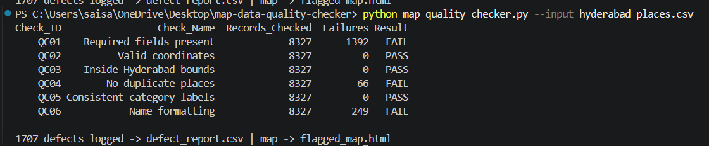
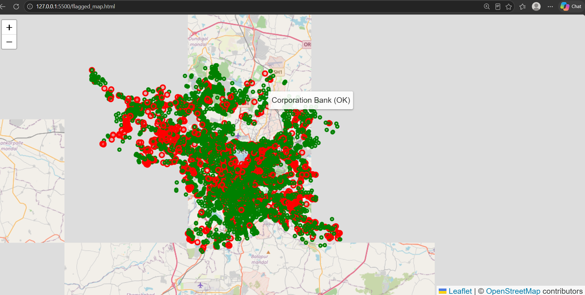
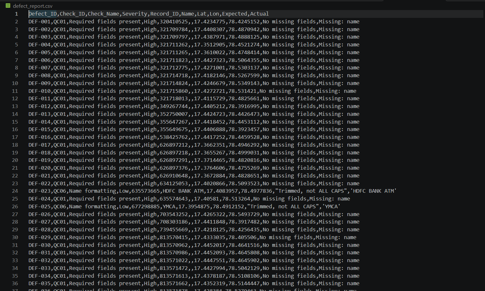
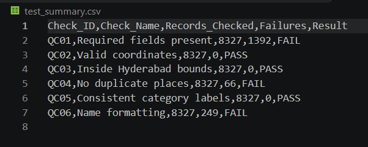
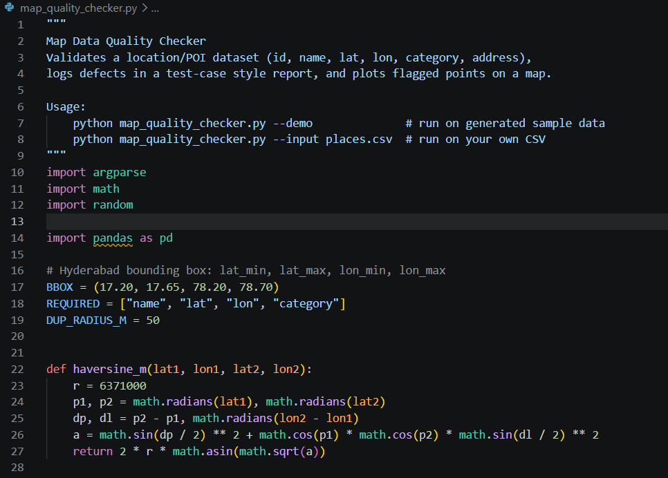
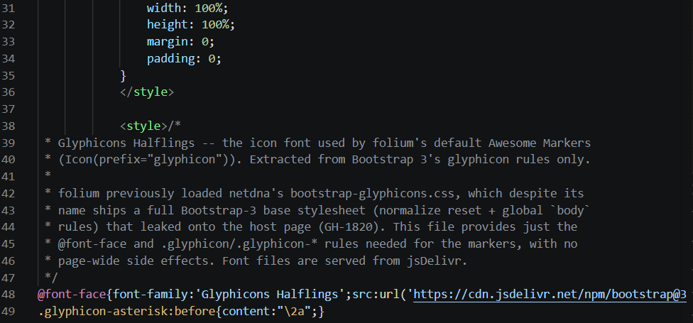

# Map Data Quality Checker

A Python tool that validates a location (POI) dataset, logs defects in a test-case style report, and plots flagged records on an interactive map.

## Checks
| ID | Check | Severity |
|----|-------|----------|
| QC01 | Required fields present (name, lat, lon, category) | High |
| QC02 | Valid coordinates (range, not 0,0) | High |
| QC03 | Point lies inside the Hyderabad bounding box | Medium |
| QC04 | No duplicate places (same name within 50 m) | Medium |
| QC05 | Consistent category labels (case/whitespace) | Low |
| QC06 | Name formatting (trimmed, not ALL CAPS) | Low |

## Run
```
pip install pandas folium
python map_quality_checker.py --input places.csv
```
Input CSV columns: `id, name, lat, lon, category, address`

## Outputs
- `defect_report.csv`: one row per defect (Defect ID, check, severity, record, expected vs actual)
- `test_summary.csv`: pass/fail per check
- `flagged_map.html`: interactive map (red = flagged, green = OK)


## Results

- Dataset: Hyderabad OpenStreetMap POIs
- Records checked: [Your actual number]
- Total defects identified: [Your actual number]

### Validation Results

- Missing required fields: [Number]
- Invalid coordinates: [Number]
- Out-of-region locations: [Number]
- Duplicate places: [Number]
- Category inconsistencies: [Number]
- Name formatting issues: [Number]

## Project Screenshots

### 1. Project Execution
Shows the successful execution of the Python validation program.



### 2. Interactive Map Visualization
Displays geographical records and flagged locations using Folium.



### 3. Defect Report
Displays identified data quality issues with severity and expected versus actual results.



### 4. Test Execution Summary
Displays the results of all six data validation checks.



### 5. Python Validation Implementation
Shows the Python code used for data validation and defect identification.



### 6. Map Visualization Implementation
Shows the code used to generate the interactive geographical map.



## 👩‍💻 About the Developer

**Sai Sangeetha Padakanti**

Computer Science and Engineering Graduate (2026)  
Vaageswari College of Engineering, JNTUH  
Hyderabad, Telangana, India

I am an aspiring IT professional interested in software quality, manual testing, data validation, and technology-driven solutions.

This project demonstrates my practical understanding of Python programming, data validation, defect identification, test case documentation, and map-based data visualization.

### Connect with Me

- **Email:** saisangeetha4925@gmail.com
- **LinkedIn:** https://linkedin.com/in/saisangeethapadakanti
- **GitHub:** https://github.com/saisangeetha-25

---
*Developed as a portfolio project to demonstrate practical skills in map data quality validation and testing.*
